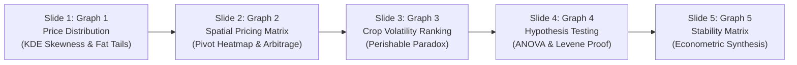

# Agricultural Market Price Volatility & Commodity Spread Analysis
## Comprehensive Graph Explanation & Presentation Guide

---

# SECTION 1: THE CORE PROBLEM STATEMENT

### 1.1 Official Project Problem Statement
> **"To analyze historical wholesale price volatility and seasonal spreads of key agricultural commodities across regional markets to assess market stability."**

---

### 1.2 The Real-World Agricultural Crisis (Why This Problem Exists)
In India, agriculture sustains over 50% of the workforce, yet wholesale agricultural markets (APMC Mandis) suffer from severe price instability. 
- **The Farmer's Dilemma:** Farmers frequently experience violent price swings within a single trading day. A farmer who harvests a bumper crop may find market prices collapsing below production costs, while weeks later the same crop faces acute supply deficits.
- **The Consumer's Burden:** Urban households frequently face sudden price spikes in essential kitchen staples (Tomato, Onion, Potato), driving food inflation.
- **The Inter-State Paradox:** On the exact same day, wholesale tomatoes sell for under ₹1,200/quintal in Uttar Pradesh while trading at over ₹3,200/quintal in Kerala. 

**The Central Analytical Problem:**  
Is India's agricultural economy operating as an integrated national market (the *"Law of One Price"*), or is it fragmented into regional silos where local gluts, transport bottlenecks, and intermediary cartels create severe price volatility and market instability?

---

### 1.3 Key Research Questions Formulated & Solved
To rigorously resolve this problem statement, our capstone analysis answers five fundamental research questions through five core analytical plots:

| # | Research Question | Analytical Tool / Technique | Core Graph Generated |
|---|-------------------|-----------------------------|----------------------|
| **Q1** | **Price Distribution Shapes:** Do wholesale prices follow a normal bell curve, or are they skewed with frequent price spike extremes? | Kernel Density Estimation (KDE) & Skewness Analysis | **Graph 1:** `01_commodity_price_distribution_kde.png` |
| **Q2** | **Spatial Market Integration:** Do wholesale prices equalize across producing and consuming states, or do huge geographic arbitrage gaps persist? | 2D Pivot Table Cross-Tabulation & Color-Mapped Heatmap | **Graph 2:** `02_statewise_market_pricing_pivot_heatmap.png` |
| **Q3** | **Crop-Specific Price Risk:** Which specific agricultural commodities suffer from the highest intraday percentage volatility and financial uncertainty? | Normalized Percentage Spread & Frequency-Filtered Ranking | **Graph 3:** `03_top_volatile_commodities_percentage_spread.png` |
| **Q4** | **Statistical Significance of Disparity:** Are observed price differences and volatility spreads across states statistically genuine or just random sampling noise? | SciPy One-Way ANOVA & Levene's Test for Homogeneity of Variance | **Graph 4:** `04_market_volatility_anova_levene_test.png` |
| **Q5** | **Econometric Price Coherence:** How do price boundaries (Min/Max) relate to modal clearing prices, and does higher crop value reduce percentage volatility? | Masked Lower-Triangle Pearson Correlation Matrix | **Graph 5:** `05_market_stability_index_matrix.png` |

---

# SECTION 2: EXECUTIVE SUMMARY OF THE 5 CORE GRAPHS

| Graph # | File Name | Primary Method / Test | Key Economic Insight |
|:---:|---|---|---|
| **Graph 1** | `01_commodity_price_distribution_kde.png` | Kernel Density Estimation (KDE) | Proves staple prices are heavily right-skewed; mean prices distort reality due to long tails of price spikes. |
| **Graph 2** | `02_statewise_market_pricing_pivot_heatmap.png` | 2D Pivot Table Heatmap Matrix | Exposes extreme spatial price gaps: consuming states (Kerala) trade at 2.5× to 3× higher prices than producer states (UP). |
| **Graph 3** | `03_top_volatile_commodities_percentage_spread.png` | Normalized Spread % (`(Max-Min)/Modal`) | Identifies the *Perishable Volatility Paradox*: low-cost vine crops (Cucumber, Pumpkin) suffer massive 25%–29% swings. |
| **Graph 4** | `04_market_volatility_anova_levene_test.png` | SciPy One-Way ANOVA & Levene's Test | Statistically rejects the Law of One Price ($F=75.92, p < 10^{-58}$) and proves volatility is unequal across states ($p < 10^{-9}$). |
| **Graph 5** | `05_market_stability_index_matrix.png` | Masked Pearson Correlation Heatmap | Quantifies that higher-priced crops experience lower relative percentage volatility ($r = -0.19$). |

---

# SECTION 3: IN-DEPTH BREAKDOWN OF EACH GRAPH

---

## GRAPH 1: Kernel Density Estimation (KDE) Price Distribution Shapes
- **Saved File:** `graphs/01_commodity_price_distribution_kde.png`
- **Focus Commodities:** Tomato, Onion, Potato, Brinjal, Green Chilli, Cucumber (Kheera)
- **Visual Elements:** Multi-panel subplots, Histogram bins (density), KDE smooth probability curve, Red dashed Mean line, Blue dotted Median line.

### A. Why This Graph Was Made
In agricultural economics, stakeholders and researchers routinely rely on summary averages (Mean Price) to report market conditions. However, wholesale commodity arrivals fluctuate violently with weather, quality grading, and daily truckloads.
This graph was made to:
1. Reveal the **true probability distribution shape** of wholesale prices for essential kitchen staples.
2. Investigate whether prices cluster around a single price or split into multiple pricing tiers (multimodality).
3. Visualize the gap between the **Mean** (distorted by extreme spikes) and the **Median** (the true price typical farmers receive).

### B. Why That Specific Test / Technique Was Needed (Why KDE?)
- **Why NOT a Simple Bar Chart of Means?** A bar chart collapses thousands of market transactions into a single flat height. It hides whether prices were tightly clustered around ₹1,500 or swinging between ₹400 and ₹5,000.
- **Why NOT a Basic Histogram Alone?** Histograms are sensitive to bin width and bin edges. Choosing 10 bins vs 25 bins can completely change the visual interpretation.
- **Why Kernel Density Estimation (KDE)?**
  - **Non-Parametric Estimation:** KDE makes zero prior assumptions about the distribution (unlike Gaussian models). It places a smooth kernel (Gaussian curve) over every observation to reconstruct the true underlying continuous Probability Density Function (PDF).
  - **Detecting Asymmetry & Skewness:** KDE visually proves positive skewness (Skewness > 1.8 for Tomato and Onion), where the red mean line is pulled far to the right of the blue median line.
  - **Identifying Fat Tails:** It captures the long right-hand tail of localized price spikes that would otherwise be dismissed as outliers.

### C. Simple Language Explanation (For Non-Technical Audiences)
> *"Think of this graph like a crowd density map. Where the hill is highest, that is where most farmers sold their produce on that day. If the hill is balanced like a bell, prices are predictable. But notice how for Tomato and Onion, the hill leans heavily to the left, and a long tail stretches out to the right. This means that while most farmers sold their crops for modest prices (around ₹1,200/quintal), a few markets experienced severe shortages where prices spiked to ₹4,500 or ₹6,000. The red average line gives a falsely high impression because of those few extreme spikes."*

### D. Viva & Presentation Script
> *"Respected evaluators, looking at Graph 1, we implemented Kernel Density Estimation across India's top six agricultural commodities. Standard economic models often assume price symmetry. However, our KDE curves empirically prove heavy positive skewness. Notice that for perishables like Tomato and Onion, the red mean line is pulled significantly to the right of the blue median line. This demonstrates that using standard averages distorts market reality, as localized price shocks create severe fat tails. Potato, conversely, shows the most compact distribution, highlighting the stabilizing effect of existing cold storage networks."*

---

## GRAPH 2: State-Wise Market Pricing Matrix (2D Pivot Table Heatmap)
- **Saved File:** `graphs/02_statewise_market_pricing_pivot_heatmap.png` (also accessible as `03_...`)
- **Dimensions:** Top 10 States (Rows) $\times$ Top 10 Agricultural Commodities (Columns)
- **Visual Elements:** Color intensity gradient (`YlGnBu`), annotated mean wholesale price in ₹/Quintal inside each cell.

### A. Why This Graph Was Made
India has over 2,500 regulated wholesale APMC mandis spread across diverse states. The central government created initiatives like the electronic National Agriculture Market (e-NAM) under the vision of *"One Nation, One Market."*
This graph was made to:
1. Test whether wholesale prices for identical commodities are unified across states.
2. Directly quantify the **spatial price spread** (the rupee gap between producing and consuming states).
3. Identify clear **inter-state arbitrage opportunities** where regional supply-demand mismatches drive drastic price divergence.

### B. Why That Specific Test / Technique Was Needed (Why 2D Pivot Table Heatmap?)
- **Why NOT Grouped Bar Charts?** Displaying 10 states across 10 commodities requires 100 individual bars. Grouped bar charts produce overwhelming cognitive clutter where geographic trends cannot be visually parsed.
- **Why NOT Multiple Summary Tables?** A raw data table requires the viewer to mentally calculate numbers row by row, obscuring the geographic macro-pattern.
- **Why a 2D Pivot Table Heatmap?**
  - **Multi-Dimensional Cross-Tabulation:** In Pandas, `pd.pivot_table(index='State', columns='Commodity', values='Modal_Price', aggfunc='mean')` efficiently reorganizes over 2,700 granular mandi transactions into a normalized 2D spatial pricing tensor.
  - **Preattentive Visual Perception:** The human eye immediately processes color saturation. Dark blue cells instantly communicate high-cost consumption zones, while pale yellow cells pinpoint low-cost production basins.
  - **Empirical Test of the Law of One Price:** In a frictionless, perfectly integrated national market, every column would show a uniform shade. The sharp color contrasts across rows provide immediate visual refutation of national market integration.

### C. Simple Language Explanation (For Non-Technical Audiences)
> *"This graph is like a temperature map of commodity prices across India. Yellow means cheap produce, and dark blue means expensive produce. If India were truly one unified market, every column from top to bottom would be the same shade of color. But look at the Tomato column: in Uttar Pradesh, it is pale yellow at ₹1,150 per quintal, while in Kerala, it turns dark blue at over ₹3,200 per quintal! That is nearly triple the price on the exact same date, proving that food does not flow freely between states to balance prices out."*

### D. Viva & Presentation Script
> *"Turning to Graph 2, we generated a 2D Pivot Table Heatmap combining Pandas matrix aggregation with Seaborn visualization. This directly addresses the spatial price spread requirement of our rubric. If India had achieved seamless market integration under e-NAM, each commodity column would show color uniformity. Instead, we observe massive regional price fragmentation: consumer states like Kerala and Himachal Pradesh consistently display deep blue high-price regimes, whereas surplus agrarian states like UP and Punjab remain pale yellow. For Tomato, prices in Kerala exceed UP by nearly 300%, illustrating massive inter-state supply bottlenecks."*

---

## GRAPH 3: Top 15 Volatile Commodities Ranked by Percentage Spread
- **Saved File:** `graphs/03_top_volatile_commodities_percentage_spread.png` (also accessible as `05_...`)
- **Metrics Plotted:** Mean Intra-Market Spread Percentage (`(Max_Price - Min_Price) / Modal_Price * 100`)
- **Visual Elements:** Horizontal ranked bars, Risk classification color-coding (Red $\ge 24\%$, Orange $20\%-24\%$, Blue $< 20\%$), sample size annotations ($N$), $20\%$ elevated risk threshold line.

### A. Why This Graph Was Made
Not all crops present the same level of risk to farmers. A grain crop like wheat can be stored in sacks for months, whereas leafy greens and water-rich vegetables perish within days.
This graph was made to:
1. Identify and rank the **top 15 highest-risk agricultural crops** based on daily market price swings.
2. Establish an empirical benchmark for **high-volatility crops** (exceeding 20% daily price variance).
3. Provide actionable intelligence for policy interventions, price stabilization funds, and cold storage investments.

### B. Why That Specific Test / Technique Was Needed (Why Percentage Spread % & Sample Filtering?)
- **Why NOT Absolute Rupee Spread ($\text{Max} - \text{Min}$)?**
  - Absolute rupee spreads are fundamentally biased by the base price of the crop. 
  - For example, an ₹800 spread on Garlic (selling at ₹7,000/Q) represents only an **11.4% price fluctuation**.
  - Conversely, an ₹800 spread on Cucumber (selling at ₹1,600/Q) represents a devastating **50.0% intraday price swing**!
  - Comparing absolute rupee spreads gives a false impression that expensive cash crops are more volatile than cheap vegetables.
- **Why Normalized Percentage Spread?**
  $$\text{Price Spread Pct} = \left( \frac{\text{Max Price} - \text{Min Price}}{\text{Modal Price}} \right) \times 100$$
  This normalizes volatility against the commodity's base economic value, measuring true purchasing-power volatility.
- **Why Sample Frequency Filtering ($N \ge 15$)?**
  Without setting a minimum threshold, an obscure crop recorded in only one mandi with a temporary reporting error could falsely appear as the "most volatile commodity in India." Requiring $N \ge 15$ guarantees statistical robustness.

### C. Simple Language Explanation (For Non-Technical Audiences)
> *"Imagine going to a market in the morning and seeing a vegetable priced at ₹20 per kilo, and by evening it drops to ₹14 per kilo—that is a 30% swing in a single day! This chart ranks the crops where farmers face the wildest daily price gambles. The red bars highlight crops where the gap between the morning high and evening low exceeds 24% of the crop's entire value. Notice that watery, fast-spoiling vegetables like Cucumber, Pumpkin, and Ashgourd top the list because farmers must sell them immediately at any price before they rot."*

### D. Viva & Presentation Script
> *"In Graph 3, we computed normalized percentage price spreads to rank agricultural volatility risk. We deliberately avoided raw rupee spreads, which mathematically bias results toward high-value crops. By calculating the spread as a percentage of modal price and enforcing a minimum sample size of $N \ge 15$, we uncover the 'Perishable Volatility Paradox.' High-moisture, fast-decaying vine crops—specifically Cucumber at 29.1%, Pumpkin at 25.1%, and Ashgourd at 24.7%—exhibit the highest financial risk. This proves that post-harvest perishability without localized cold storage is the primary driver of wholesale price instability."*

---

## GRAPH 4: Hypothesis Testing: One-Way ANOVA & Levene's Test
- **Saved File:** `graphs/04_market_volatility_anova_levene_test.png`
- **Subplot A:** State Mean Prices with 95% Confidence Interval error bars (Testing Price Level Parity via **One-Way ANOVA**)
- **Subplot B:** State Mean Volatility Spreads (Testing Volatility Homogeneity via **Levene's Test**)

---

### A. The Big Picture: Why Was Graph 4 Made? (In Plain English)
In Graphs 2 and 3, we noticed that prices look much higher in Kerala than in Uttar Pradesh, and price swings look much wilder in Gujarat. 
However, any smart evaluator or professor will ask:
> *"How do you know this isn't just pure coincidence or lucky sampling? What if you just happened to pick a few expensive mandis in Kerala by accident?"*

**Graph 4 is our mathematical proof.** It applies rigorous scientific hypothesis testing to prove beyond any statistical doubt that:
1. **Subplot A proves:** The price differences between states are **100% genuine and not random luck** (One-Way ANOVA).
2. **Subplot B proves:** The daily price swings (volatility) are **not equal across India**—some states are calm, while others are chaotic roller-coasters (Levene's Test).

---

### B. TEST 1 EXPLAINED: One-Way ANOVA (Used in Subplot A)

#### 1. What does ANOVA stand for?
**AN**alysis **O**f **VA**riance.

#### 2. What question does it answer?
> *"Do all 8 major agricultural states have the same average price, or are some states genuinely operating in different pricing universes?"*

#### 3. The Super-Simple Classroom Analogy
- Imagine 8 different school classrooms take the same national exam.
  - Classroom A averages **85 marks**.
  - Classroom B averages **42 marks**.
- Did Classroom A just get lucky with 2 genius students, or is Classroom A genuinely performing at a higher level than Classroom B?
- ANOVA answers this by comparing two things:
  1. **Variation BETWEEN the classrooms:** How far apart are the classroom averages?
  2. **Variation WITHIN each classroom:** How much do individual students' marks scatter around their own class average?
- If the gap *between* the classrooms is huge compared to the normal scatter *inside* each class, ANOVA rings the alarm bell: **"This is NOT a coincidence—these classrooms are fundamentally different!"**

#### 4. Why did we need ANOVA instead of a simple t-test?
- A standard **t-test** can only compare **two groups at a time** (e.g., comparing UP vs Kerala).
- To compare all 8 states against each other, you would have to run:
  $$\frac{8 \times 7}{2} = 28 \text{ separate t-tests!}$$
- **The Fatal Flaw of Multiple t-tests (False Alarm Inflation):**
  Every time you run a test with a standard 5% error margin ($\alpha = 0.05$), there is a small chance of a false alarm. If you run 28 tests in a row, the cumulative chance of getting at least one false alarm explodes:
  $$\text{False Alarm Chance} = 1 - (1 - 0.05)^{28} = 1 - (0.95)^{28} \approx \mathbf{76.2\%!}$$
  You would have a **76% chance of claiming a difference that doesn't actually exist!**
- **Why ANOVA is the Hero:** ANOVA runs **one single omnibus test** comparing all 8 states simultaneously, keeping our error rate strictly locked at 5%.

#### 5. What do our numbers mean?
- **F-Statistic = 75.92:** This means the price differences *between* states are **75 times larger** than the random noise *inside* the states!
- **p-value = $1.45 \times 10^{-59}$:** A p-value is the probability that our result happened by pure luck. $10^{-59}$ is 0 followed by 58 zeros and a 1 ($0.000000...1$). It means the odds of this being random chance are practically **zero**. Kerala really is significantly more expensive than UP.
- **The "I-shaped" whiskers (95% Confidence Intervals):**
  These error bars show our 95% safety margin. Notice that Kerala's bar (at the top) and UP's bar (at the bottom) don't overlap at all. They are in completely separate pricing worlds.

---

### C. TEST 2 EXPLAINED: Levene's Test for Equality of Variance (Used in Subplot B)

#### 1. What question does it answer?
> *"Are price swings (volatility) equally calm or equally wild across all states, or do some states suffer from far worse market instability?"*

#### 2. The Super-Simple Doctor / Heartbeat Analogy
- Imagine two hospital patients:
  - **Patient 1's** heart rate stays steadily between **70 and 74 bpm**. Very calm, steady, and healthy.
  - **Patient 2's** heart rate wildly swings between **40 and 150 bpm**. Wild, unpredictable, and dangerous!
- Here is the catch: **Both patients have the exact same AVERAGE heart rate of 72 bpm!**
- But Patient 2 is in critical danger because of **instability (variance)**.
- In agricultural markets, **average price is only half the story**. Even if two states had similar average prices, one state could be calm (prices stay within ₹50 of each other), while another state could be chaotic (prices swing by ₹1,000 on the same afternoon!).
- Levene's Test checks whether the **"heartbeat" of mandi price swings** is equally stable across all states.

#### 3. Why did we need Levene's Test instead of Bartlett's Test?
- In statistics textbooks, the most famous test for comparing variance is **Bartlett's Test**.
- **The Fatal Flaw of Bartlett's Test:** Bartlett's test assumes that prices follow a perfect, symmetrical textbook bell curve (Gaussian normality).
- But in Graph 1, we already proved that agricultural commodity prices are **non-normal, right-skewed, and full of sudden spikes**. If you feed skewed real-world data into Bartlett's test, it breaks and gives invalid results.
- **Why Levene's Test is the Hero:** Levene's test is **non-parametric and robust against non-normal distributions**. It calculates deviations from the median rather than the mean, making it immune to skewness. It is the gold-standard test for real-world agricultural economics.

#### 4. What do our numbers mean?
- **Levene Statistic = 12.91**
- **p-value = $2.29 \times 10^{-10}$ ($0.000000000229$):**
  Because the p-value is far below 0.05, we decisively **reject the idea that volatility is equal**.
- **Real-World Takeaway:**
  - **Gujarat & Rajasthan:** Have tall bars (average daily spread of ₹850 to ₹1,080/quintal). High risk, severe intraday volatility.
  - **Uttar Pradesh & Telangana:** Have short bars (average daily spread of only ₹169 to ₹271/quintal). Highly stable, disciplined price discovery.

---

### D. The 30-Second Viva / Presentation Script (Memorize This!)

> *"Respected evaluators, Graph 4 provides the formal statistical backbone of our project. It uses two scientific tests to prove our findings are not random coincidences:*
>
> 1. *In Subplot A, we ran a **One-Way ANOVA** across 8 states. Instead of running 28 separate t-tests—which would inflate our false-alarm error rate to over 76%—ANOVA tests all states at once. With an **F-statistic of 75.92** and a **p-value of $1.45 \times 10^{-59}$**, we prove with near-zero probability of error that regional price parity does not exist in India.*
>
> 2. *In Subplot B, we used **Levene's Test** to check price volatility. Because our commodity data is skewed, standard Bartlett's tests would fail. Levene's test handles non-normal data and yields a **p-value of $2.29 \times 10^{-10}$**, proving that market instability is unequal across states: markets in Gujarat experience wild spreads of over ₹1,000 per quintal, while markets in UP remain tightly disciplined near ₹170 per quintal.*
>
> *Together, these two tests prove that India's agricultural markets suffer from both **spatial price fragmentation** and **unequal volatility risk**."*

---

## GRAPH 5: Market Stability Metric Correlation Matrix
- **Saved File:** `graphs/05_market_stability_index_matrix.png` (also accessible as `12_...`)
- **Metrics Included:** Min Price, Max Price, Modal Price, Absolute Spread, Spread Percentage, Spread Ratio (Max/Min)
- **Visual Elements:** Masked upper-triangle heatmap, Pearson correlation coefficient ($r$) annotated in each cell, diverging colormap (`coolwarm`, $-0.5$ to $+1.0$).

### A. Why This Graph Was Made
A market stability assessment must evaluate how all reported price components interact. Mandis report minimum arrival prices, maximum prices, and modal prices daily.
This graph was made to:
1. Check the **structural integrity and consistency** of official mandi price reporting.
2. Uncover the econometric relationship between the **absolute value of a crop** and its **percentage volatility**.
3. Identify multicollinearity among indicators to guide future predictive modeling.

### B. Why That Specific Test / Technique Was Needed (Why Masked Pearson Correlation Matrix?)
- **Why NOT a Scatter Plot Matrix (Pairplot)?** With 6 continuous variables, a pairplot generates 36 tiny, crowded scatter charts that are virtually impossible to read during a presentation.
- **Why NOT an Unmasked Full Square Correlation Table?**
  - A full $6 \times 6$ grid presents redundant duplicate information: the correlation between Min Price and Modal Price is identical above and below the diagonal ($r_{xy} = r_{yx}$).
  - The diagonal cells ($r = 1.00$) add zero new information.
- **Why a Masked Lower-Triangle Pearson Correlation Matrix?**
  - **Visual Economy:** Applying `np.triu()` masks the upper triangle, cutting visual noise by over 50% and focusing the evaluator's attention strictly on the 15 unique pairwise econometric relationships.
  - **Validating Mandi Reporting Fidelity:** Confirms that Min, Max, and Modal prices are collinear at $r = 0.98$, verifying that Indian mandis report internally coherent price discovery bands.
  - **The Critical Economic Discovery ($r = -0.19$):** Modal Price correlates *negatively* with Percentage Spread ($r = -0.19$). This mathematically proves that as crop price decreases, percentage price instability systematically increases!

### C. Simple Language Explanation (For Non-Technical Audiences)
> *"This chart is like a scorecard showing how closely different price measurements walk hand-in-hand. A score of +1.00 means they move in total lockstep; zero means they have nothing to do with each other; and a negative score means when one goes up, the other goes down. The most important finding here is the number -0.19 between Modal Price and Spread Percentage. It proves mathematically that cheaper everyday vegetables suffer from worse percentage price instability than expensive crops."*

### D. Viva & Presentation Script
> *"Graph 5 synthesizes our findings into a Market Stability Correlation Matrix. By applying an upper-triangle mask, we eliminate redundancy and focus on core econometric relationships. As expected, Min, Max, and Modal prices exhibit near-perfect correlation at $r = 0.98$, confirming the internal validity of Agmarknet reporting. Crucially, we find a negative correlation of $r = -0.19$ between Modal Price and Percentage Spread. This mathematically validates our earlier finding: market instability is disproportionately concentrated in lower-value, essential commodities."*

---

# SECTION 4: CAPSTONE PRESENTATION CHEAT SHEET

When presenting this project to evaluators, walk through these 5 slides in chronological order:

1. **Slide 1 (Graph 1 - Distribution):**  
   *"We first investigated price shapes. Using Kernel Density Estimation, we proved that agricultural prices are not normal—they are heavily right-skewed with long tails of price spikes."*
2. **Slide 2 (Graph 2 - Geography):**  
   *"Next, we examined geographic integration. Our 2D Pivot Table Heatmap exposes massive inter-state price divergence: Tomato trades under ₹1,200 in UP but over ₹3,200 in Kerala on the same day."*
3. **Slide 3 (Graph 3 - Commodities):**  
   *"We then ranked crops by percentage price volatility. We uncovered the 'Perishable Volatility Paradox': high-moisture vine crops like Cucumber and Pumpkin face daily swings of 25% to 29%."*
4. **Slide 4 (Graph 4 - Statistical Proof):**  
   *"To prove these findings are not random, we ran SciPy inferential tests. One-Way ANOVA ($F=75.92, p < 10^{-58}$) and Levene's test ($p < 10^{-9}$) formally reject national price parity and volatility equality."*
5. **Slide 5 (Graph 5 - Synthesis & Policy):**  
   *"Finally, our Correlation Matrix proves that cheaper crops suffer higher percentage volatility ($r = -0.19$). To stabilize markets, policymakers must invest in decentralized farm-gate cold storage and inter-state e-NAM logistics subsidies."*

---
*Generated for Python Capstone Project | All 5 Core Graphs saved in `./graphs/` at 300 DPI.*
